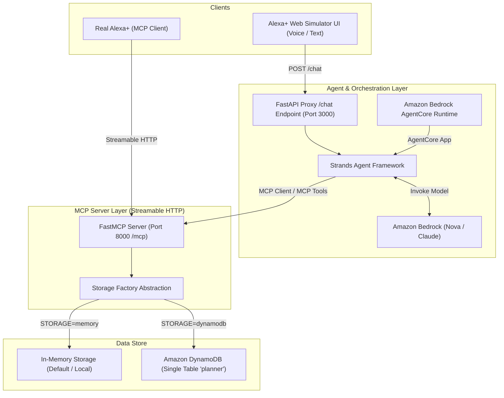

# MyAlexa — Voice-First Daily Planner MCP Server & Alexa+ Simulator

[](https://modelcontextprotocol.io)
[](https://python.org)
[](https://aws.amazon.com/bedrock/)

> A hackathon project delivering a voice-first daily planner as a self-hosted **Model Context Protocol (MCP)** server for **Alexa+**, paired with a Strands Agent and a stunning Alexa-style web UI simulator.

---

## 🎯 Problem Statement & Solution

**Problem:** Standard voice assistants struggle with dynamic daily planning, context-aware calendar slot fitting, and multi-step task organization. Users are often forced to handle complex scheduling manually or deal with robotic, list-heavy responses.

**Solution:** **MyAlexa** delivers a dedicated, voice-first MCP server with 6 specialized planner tools. It calculates free calendar gaps between 09:00 and 18:00, schedules pending tasks using shortest-fit optimization, and returns natural 1-3 sentence spoken responses suitable for text-to-speech. With zero required AWS dependencies in memory mode (`STORAGE=memory`), it can run entirely locally or scale up seamlessly to **Amazon DynamoDB**, **Amazon Bedrock**, and **Bedrock AgentCore Runtime**.

---

## 🏗️ System Architecture



---

## 🛠️ MCP Tools Overview

All tools enforce voice-friendly plain-text output (no markdown formatting, no tables, no bullet points).

| Tool Name | Parameters | LLM Guidance / When to Use | Spoken Output Example |
|---|---|---|---|
| `add_event` | `title` (str), `date` (str="today"), `start_time` (str="09:00"), `end_time` (str="10:00") | Use when scheduling an event/meeting. Rejects overlaps with friendly spoken message. | *"I've added Team Sync to your schedule today from 10:00 to 11:00."* |
| `get_agenda` | `date` (str="today") | Use when asked for agenda or schedule summary for "today", "tomorrow", or ISO date. | *"You have 2 events today: Team Sync at 10:00 and Coffee Break at 14:00."* |
| `add_task` | `title` (str), `due` (str=""), `duration_min` (int=30) | Use when adding a to-do item or action item to the task list. | *"Added task 'Call dentist' to your to-do list."* |
| `list_tasks` | *None* | Use when asked to read pending tasks. Returns up to 5 items, then "and N more". | *"You have 3 pending tasks: Call dentist, Buy groceries, and Submit report."* |
| `complete_task` | `title_or_id` (str) | Use when marking a task complete. Supports exact ID and fuzzy title matching. | *"Great job! I've marked 'Call dentist' as complete."* |
| `plan_my_day` | `date` (str="today") | **Showpiece tool.** Computes free gaps (09:00-18:00), fits tasks, saves plan, returns spoken summary. | *"I've planned your day! I scheduled Call dentist from 09:00 to 09:30 and Write code from 11:00 to 12:00."* |

---

## ☁️ AWS Integration Details

| AWS Service | Component Role & Functionality |
|---|---|
| **Amazon Bedrock** | Serves as the Foundation Model provider via the Converse API (`boto3`). Formulates natural conversational responses and smooths schedule summaries using models such as `amazon.nova-lite-v1:0` or `anthropic.claude-3-haiku-20240307-v1`. |
| **Bedrock AgentCore** | Provides the serverless container execution environment for hosting agent entrypoints (`BedrockAgentCoreApp`). Enables high-availability serverless deployment of voice agents. |
| **Strands Agents Framework** | Agent orchestration framework (`strands-agents`) connecting LLM models (`BedrockModel`) with dynamic MCP tool discovery via `MCPClient`. |
| **Amazon DynamoDB** | Single-table NoSQL persistent backend (`pk=USER#demo`, `sk`). Stores calendar events, open tasks, and generated day plans. |

---

## 🚀 Getting Started

### 1. Installation
Clone the repository and install dependencies:
```bash
cp daybreak/.env.example daybreak/.env
pip install -r daybreak/requirements.txt
```

### 2. Run the MCP Server (Port 8000)
Default run mode uses local memory storage with zero AWS credentials:
```bash
python -m daybreak.mcp_server.server
```
*Server runs at `http://localhost:8000/mcp`.*

### 3. Run the Alexa+ Web Simulator UI (Port 3000)
In a second terminal window:
```bash
python -m daybreak.ui.app
```
Open **[http://localhost:3000](http://localhost:3000)** in your browser.

---

## 🐳 Docker Deployment

Run both the MCP server and UI simulator in Docker:
```bash
docker compose up --build
```
- Web Simulator: `http://localhost:3000`
- MCP Server: `http://localhost:8000/mcp`

---

## 🧪 Running Test Suite

Run unit tests for storage abstraction and all 6 MCP tools:
```bash
python -m pytest daybreak/mcp_server/tests/ -v
```

---

## 📦 Deploying to Bedrock AgentCore

To deploy the Strands Agent to Amazon Bedrock AgentCore Runtime:

1. **Provision DynamoDB Table**:
```bash
python daybreak/infra/create_dynamodb_table.py
```

2. **Configure Environment Variables**:
In `.env`:
```env
STORAGE=dynamodb
AWS_REGION=us-east-1
BEDROCK_MODEL_ID=us.amazon.nova-lite-v1:0
MCP_URL=http://<your-mcp-host>:8000/mcp
```

3. **Launch AgentCore Runtime App**:
```bash
python -m daybreak.agent.agentcore_app
```

---

## 🎬 2-3 Minute Video Demo Script

1. **Introduction (0:00 - 0:30)**:
   - *"Hi! This is MyAlexa, a voice-first daily planner built as an MCP server for Alexa+ and Bedrock AgentCore."*
   - Show the Web UI with glowing cyan mic ring and the "Simulated Alexa+ experience" badge.
2. **Adding Tasks & Events (0:30 - 1:15)**:
   - Click chip or speak: *"Add a task to call the dentist"* -> Watch the inspector side panel log the `add_task` MCP tool execution with parameters.
   - Speak: *"Add a meeting with Team at 10 AM"* -> Demonstrate event creation and `add_event` tool call.
3. **Showpiece: Planning the Day (1:15 - 2:15)**:
   - Click chip or speak: *"Plan my afternoon"* -> Watch `plan_my_day` execute, calculate free gaps between 09:00 and 18:00, assign open tasks, and speak back a natural schedule summary.
   - Point to the live JSON argument resolution in the right inspector side panel.
4. **Conclusion & AWS Integrations (2:15 - 3:00)**:
   - Highlight single-table DynamoDB design, Strands Agent orchestration, and Bedrock AgentCore hosting.
